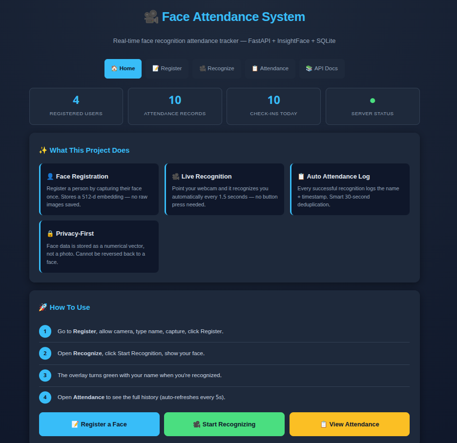
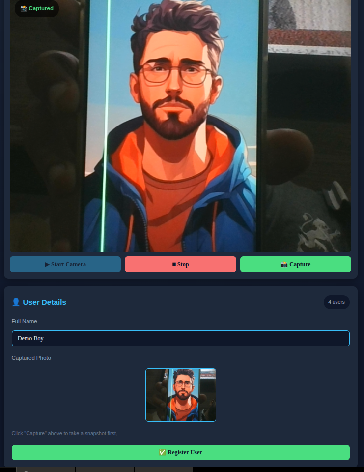
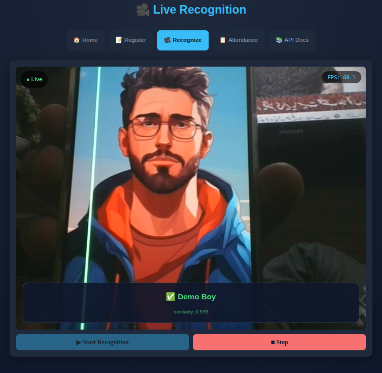
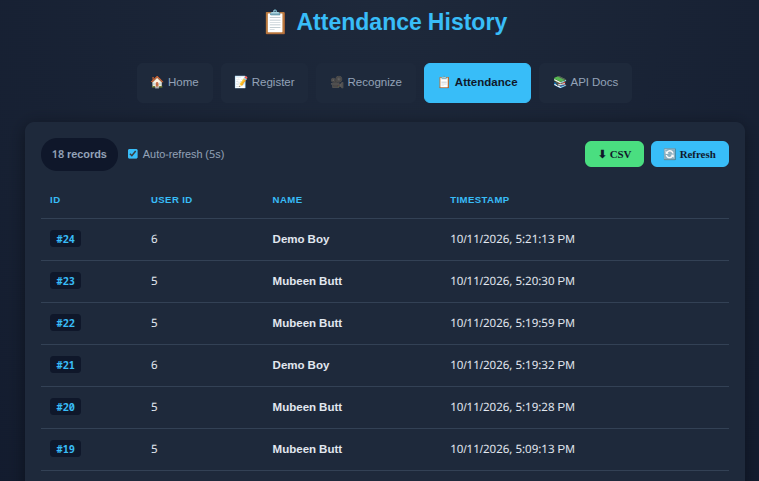

# 🎥 Face Attendance System

A real-time face recognition attendance system built with **FastAPI**, **InsightFace**, and **SQLite**. Register a person once, then let the webcam recognize them automatically and log attendance — all through a clean browser UI.


---

## ✨ Features

- 👤 **Face Registration** — capture and register a face via browser webcam
- 🎥 **Live Recognition** — auto-detects and identifies registered faces in real time
- 📋 **Auto Attendance Log** — records every check-in with 30-second deduplication
- 🏠 **Home Dashboard** — live stats, user list, delete users
- 📊 **Attendance History** — view, auto-refresh (5s), and export to CSV
- 🔒 **Privacy-First** — stores 512-d embeddings, never raw photos
- ⚡ **Lightweight** — runs at 20-30 FPS on a low-end CPU (MobileFaceNet model)
- 🌐 **100% Browser-Based** — no desktop app needed
- 🖥️ **Desktop Camera Mode** — standalone OpenCV script (`app/camera.py`) for local webcam recognition without a browser

---

## 📸 Screenshots

### 🏠 Home Dashboard


### 📝 Register a Face


### 🎥 Live Recognition


### 📋 Attendance History


## 🛠️ Tech Stack

| Layer | Technology |
|-------|------------|
| Backend | FastAPI + Uvicorn |
| Face AI | InsightFace (buffalo_s / MobileFaceNet) |
| Image Processing | OpenCV |
| Database | SQLite + SQLAlchemy |
| Frontend | Vanilla HTML / CSS / JavaScript |
| Server | Python 3.9+ |

---

## 📁 Project Structure

```
face-attendance/
├── app/
│   ├── __init__.py
│   ├── main.py              # FastAPI routes and app setup
│   ├── database.py          # SQLite connection + session
│   ├── models.py            # SQLAlchemy tables (User, Attendance)
│   ├── schemas.py           # Pydantic request/response models
│   ├── face_engine.py       # InsightFace wrapper (detect + embed)
│   └── camera.py            # Optional standalone webcam script
│
├── static/                  # Browser UI
│   ├── home.html            # Dashboard with stats + user list
│   ├── index.html           # Register new user
│   ├── recognize.html       # Live recognition
│   └── attendance.html      # Attendance history
│
├── requirements.txt
├── run.py                   # Launcher
├── .gitignore
└── README.md
```

---

## 🚀 Setup & Run

### 1. Clone the repository

```bash
git clone https://github.com/BobiButt/face-attendance.git
cd face-attendance
```

### 2. Create a virtual environment (recommended)

**Windows:**
```bash
python -m venv venv
venv\Scripts\activate
```

**macOS / Linux:**
```bash
python3 -m venv venv
source venv/bin/activate
```

### 3. Install dependencies

```bash
pip install -r requirements.txt
```

> **Note:** On first run, InsightFace will auto-download its model files (~30 MB) to `~/.insightface/models/`. This happens once.

### 4. Start the server

```bash
python run.py
```

You'll see:

```
============================================================
  🎥  Face Attendance System — Running
============================================================
  🏠  Home:           http://localhost:8000/
  📝  Register:       http://localhost:8000/ui/index.html
  🎥  Recognize:      http://localhost:8000/ui/recognize.html
  📋  Attendance:     http://localhost:8000/ui/attendance.html
  📚  API Docs:       http://localhost:8000/docs
============================================================
```

### 5. Open in browser

Go to **http://localhost:8000/** — the home page loads.

> ⚠️ **Important:** You MUST access the app via `http://localhost:8000` — NOT by opening the HTML files directly (`file://`). Browsers block webcam access on `file://` for security.

---

## 📖 How to Use

### 1. Register a Face

1. Open **http://localhost:8000/ui/index.html**
2. Click **▶ Start Camera** → allow camera permission
3. Type the person's name
4. Click **📸 Capture** → a preview appears
5. Click **✅ Register User**

The face is now stored as a 512-d embedding.

### 2. Recognize Faces Live

1. Open **http://localhost:8000/ui/recognize.html**
2. Click **▶ Start Recognition**
3. Show your face to the webcam
4. Within ~1.5s, the overlay shows:
   - **✅ Name** (green) — recognized
   - **❓ Unknown** (red) — face not in database
   - **👀 No face detected** (gray)

Attendance is logged automatically.

### 3. View Attendance

1. Open **http://localhost:8000/ui/attendance.html**
2. See all check-ins with timestamps
3. Click **⬇ CSV** to export the data
4. Toggle **Auto-refresh** on/off as needed

---

## 🖥️ Desktop Camera Mode (No Browser)

Besides the browser UI, the project includes a standalone OpenCV script in `app/camera.py` that runs face recognition directly in a desktop window — no browser needed.

### Run it

```bash
python -m app.camera
```

Or:

```bash
python app/camera.py
```

A window opens showing your webcam with:
- 🟢 Green box around the detected face
- 📛 Name + similarity label (e.g. `Ali Khan (0.87)`) or `Unknown`
- ⌨️ Press **`q`** to quit

### How it works

- Detection runs **every frame** (fast).
- Full recognition (embedding comparison against all registered users) runs **every N frames** (default: every 5th frame) to keep FPS high on low-end CPUs.
- User embeddings are cached in memory at startup, so it doesn't hit the database on every frame.

### Tweak it

Edit `app/camera.py`:

```python
run_camera(engine, threshold=0.4, recognize_every=5)
```

- `threshold` — cosine similarity needed for a match (higher = stricter, fewer false positives).
- `recognize_every` — run full recognition every N frames (lower = more frequent recognition, more CPU).

---

## 🔌 API Endpoints

| Method | Endpoint | Description |
|--------|----------|-------------|
| `POST` | `/register` | Register a new user (form-data: `name`, `file`) |
| `POST` | `/recognize` | Recognize a face (form-data: `file`) |
| `POST` | `/recognize-frame` | Recognize a base64 frame (JSON: `{"image": "data:..."}`) |
| `GET`  | `/users` | List all registered users |
| `GET`  | `/attendance` | List attendance records (newest first) |
| `DELETE` | `/users/{user_id}` | Delete a user by ID |
| `GET`  | `/docs` | Interactive Swagger API docs |

**Example — Register via curl:**

```bash
curl -X POST http://localhost:8000/register \
  -F "name=Ali Khan" \
  -F "file=@ali.jpg"
```

**Example — Recognize via curl:**

```bash
curl -X POST http://localhost:8000/recognize \
  -F "file=@test.jpg"
```

**Example — Get all users:**

```bash
curl http://localhost:8000/users
```

---

## 🧠 How It Works

### Registration Flow

```
[Photo] → Face Detection → Extract 512-d Embedding → Store in SQLite
```

### Recognition Flow

```
[Webcam Frame] → Face Detection → Extract Embedding
                                ↓
                    Compare with all stored embeddings
                                ↓
              Cosine similarity > 0.4 → Match found
                                ↓
                    Log attendance + return name
```

### Why Embeddings Instead of Images?

- **Small** — 5 KB per person vs 100 KB per photo
- **Fast** — vector math instead of image comparison
- **Private** — cannot be reversed back to a face
- **Accurate** — 99.8% on LFW benchmark

---

## ⚙️ Configuration

### Change recognition threshold

In `app/main.py`:

```python
THRESHOLD = 0.4   # higher = stricter (fewer false positives)
```

### Change deduplication window

In `app/main.py` (inside `_run_recognition`):

```python
timedelta(seconds=30)   # ignore repeat check-ins within this window
```

### Change recognition speed (FPS)

In `static/recognize.html`:

```javascript
setInterval(recognizeLoop, 1500);   // lower = faster recognition, more CPU
```

### Switch to a more accurate (slower) model

In `app/main.py`:

```python
engine_face = FaceEngine(model_name="buffalo_l")   # ~170MB, slower, more accurate
```

Options: `buffalo_s` (default, fast), `buffalo_l` (accurate).

---

## 🐛 Troubleshooting

| Problem | Solution |
|---------|----------|
| Camera doesn't start | Open via `http://localhost:8000`, NOT `file://` |
| "Camera API not available" | Use Chrome / Edge / Firefox (not IE) |
| "Permission denied" | Click the 🔒 icon in the URL bar → Allow camera |
| "NotReadableError" | Another app (Zoom/Teams/OBS) is using the camera — close it |
| "No face detected" on register | Move closer to camera, better lighting, face forward |
| `ModuleNotFoundError: app` | Run `python run.py` from the project root |
| Port 8000 in use | Change port in `run.py` |
| InsightFace re-downloads models | Check `~/.insightface/models/` folder exists |

---

## 🤝 Contributing

Pull requests are welcome. For major changes, please open an issue first.

---

## 📄 License

This project is licensed under the MIT License.

---

## 🙏 Acknowledgements

- [InsightFace](https://github.com/deepinsight/insightface) — face detection + recognition
- [FastAPI](https://fastapi.tiangolo.com/) — modern Python web framework
- [OpenCV](https://opencv.org/) — image processing
- [SQLAlchemy](https://www.sqlalchemy.org/) — database ORM

---

## 📬 Contact

**Mubeen** — [@BobiButt](https://github.com/BobiButt)

Project Link: [https://github.com/BobiButt/face-attendance](https://github.com/BobiButt/face-attendance)